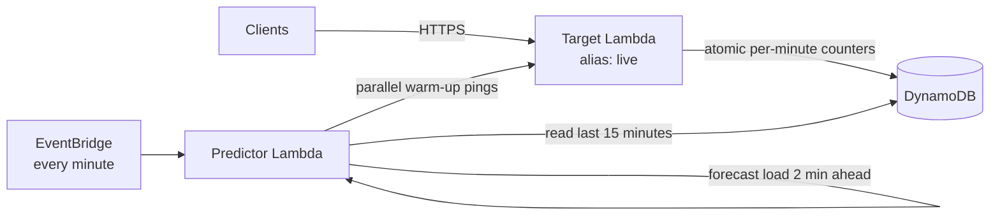
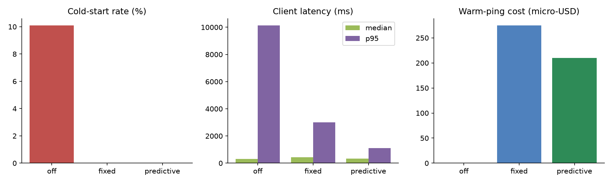

# Adaptive Cold-Start Predictor for AWS Lambda

**Live demo (in-browser simulator and real benchmark results):** https://malewarpallavi.github.io/coldstart-predictor/

A serverless system that forecasts load from per-minute invocation history and pre-warms
Lambda containers just before a predicted spike, instead of keeping containers warm all the time.
Built to learn AWS (Lambda, DynamoDB, EventBridge, CloudWatch, SAM) and to measure the
latency vs. cost trade-off of three warming strategies.

> An earlier Cloud Run / Java prototype of the same idea is kept under the git tag `gcp-prototype`.

> **Status:** the AWS stack has been deleted to avoid ongoing cost. The final version is tagged `v1.0` and redeploys in a few minutes (see [Run it](#run-it)). The live demo page above does not need AWS.

## Architecture



- **Target Lambda** (`service/app.py`): the function being measured. It reports whether each request hit a
  cold start (module-level flag, set once per container) and increments a per-minute counter in DynamoDB
  with an atomic `ADD`. Warm-up pings are not counted as user traffic.
- **Predictor Lambda** (`predictor/app.py`): runs every minute, builds features from the last 15 minutes of
  counts, evaluates a gradient-boosting model, and if a spike is forecast, sends N parallel pings that hold
  N containers in flight (Lambda runs one request per container, so N concurrent requests means N containers).
- **Strategy switch**: a config item in DynamoDB selects `off`, `fixed` (4 pings every 3 minutes) or
  `predictive`, so strategies can be compared without redeploying.
- **Infrastructure** is defined in `template.yaml` (AWS SAM).

## The forecasting model

`notebooks/forecast_experiment.py` trains a gradient-boosting regressor to predict requests in minute t+2
(the pre-warm lead time) from lagged counts, a 5-minute rolling mean, the max of the last 15 minutes, the
latest change, and the position within a 5-minute cycle. It is compared with exponential smoothing on
simulated traffic (light background load plus a spike every 5 minutes that switches on and off in blocks):

| Model | MAE | Spike recall | Precision |
|---|---|---|---|
| Exponential smoothing (baseline) | 5.78 | 0% | 0% |
| Gradient boosting | 2.29 | 93% | 85% |

The trained trees are exported to `predictor/model.json` (about 70 KB) and evaluated in plain Python inside
the Lambda, so scikit-learn does not need to be packaged. Reproduce with `python notebooks/forecast_experiment.py`.

**Limitation:** the model is trained on a simulated, periodic workload, so it largely learns the schedule.
It was made to depend on recent traffic as well (an idle system does not trigger warming), but it has not
been tested on real production traffic.

## Benchmark

`loadtest/benchmark.py` runs one strategy at a time. Every 5 minutes a spike of 28 requests arrives
(7 waves of 4 concurrent requests) on top of light background traffic. After each spike the function is
re-published, so every spike starts with no warm containers unless the strategy warmed them. Each run is
1 warm-up cycle plus 6 measured cycles (168 spike requests per strategy).

| Strategy | Cold starts | Cold rate | Median ms | p95 ms | Errors | Warm pings | Ping cost (USD) |
|---|---|---|---|---|---|---|---|
| off | 17 | 10.1% | 320 | 10139 | 13 | 0 | 0 |
| fixed | 0 | 0.0% | 437 | 3001 | 0 | 36 | 0.000275 |
| predictive | 0 | 0.0% | 333 | 1114 | 0 | 24 | 0.000210 |



**What the data supports**
- Without warming, about 10% of spike requests hit a cold start, each taking roughly 1.4 s longer than a warm request.
- Both warming strategies eliminated cold starts in this workload.
- Predictive warming used 33% fewer warm-up invocations than fixed-interval warming (24 vs 36), about 24% lower warm-up cost.

**What it does not support**
- Latency comparisons between `fixed` and `predictive`. Both had zero cold starts, and the differences in p95
  come from client-side network noise (the client ran from a home network in a different city, opening a new
  HTTPS connection per request). Medians are within noise of each other.
- 13 requests in one `off` cycle failed with status 0 (client-side timeout or connection error; Lambda
  throttling would have returned 429). They are excluded from latency statistics.
- General claims about other workloads: each strategy ran once, the workload is periodic, and the `fixed`
  baseline's interval and pool size are my choices. The fixed/predictive cost ratio depends on them.
- Costs are estimates: 256 MB, $0.0000166667 per GB-second, 1.5 s per ping plus 0.8 s of init for new
  containers. They exclude the predictor's own invocations and DynamoDB.

## Things I learned

- Lambda runs one request per container, so a burst of N concurrent requests needs N containers and causes up
  to N cold starts even when other containers are warm. The predictor has to forecast concurrency, not just rate.
- This account had a default concurrency limit of 10, so I capped spikes at 4 concurrent requests and the warm
  pool at 4. Provisioned concurrency was not evaluated for that reason (a quota increase was requested).
- Warm-up pings must be kept out of the traffic counters, otherwise the predictor feeds on its own actions.
- The first version of the model warmed containers on a completely idle system, because the simulated spikes
  never stopped and it learned the clock. Adding on/off blocks to the training data fixed it.

## Live demo page

`docs/index.html` is a single self-contained page, published with GitHub Pages. It runs the exported model
(`predictor/model.json`) in the browser against the same workload as the benchmark and models container
warm/cold state, so you can compare the three strategies, switch to idle traffic, or inject an unscheduled burst.
It is a simulation, not a live AWS call. For the benchmark's counting window it reproduces the real AWS ping
counts (36 fixed, 24 predictive) and lands within one cold start of the real result for no warming (18 vs 17).
If you retrain the model, regenerate the page with `python docs/build.py`.

## Run it

Requirements: AWS account, AWS CLI, SAM CLI, Python 3.12. To redeploy the final version: `git checkout v1.0`.

```bash
sam build && sam deploy --guided          # stack name: coldstart-predictor, region: ap-south-1
python3 -m venv .venv && source .venv/bin/activate
pip install boto3 numpy pandas scikit-learn matplotlib

python loadtest/benchmark.py --strategy off          # about 35 minutes each, run one at a time
python loadtest/benchmark.py --strategy fixed
python loadtest/benchmark.py --strategy predictive
python loadtest/summarize.py                         # table + loadtest/results.png
```

The Lambda function URL is public (no auth) for simplicity. Delete the stack when finished:

```bash
sam delete --stack-name coldstart-predictor --region ap-south-1
```

## Repository layout

```
service/        target Lambda
predictor/      predictor Lambda + exported model.json
notebooks/      forecasting experiment and model export
loadtest/       benchmark runner, summary script, results
docs/           GitHub Pages demo (index.html, build.py)
template.yaml   SAM template (Lambda x2, DynamoDB, EventBridge)
```

## Possible next steps

- Rerun the benchmark from inside the region (for example AWS CloudShell) to remove client-side network noise and compare p95 fairly.
- Train and test on real or less regular traffic, including unscheduled bursts that this model does not anticipate.
- Evaluate provisioned concurrency as a fourth strategy once the account concurrency quota allows it.
- Replace the static results page with a live dashboard that reads the DynamoDB counters.
